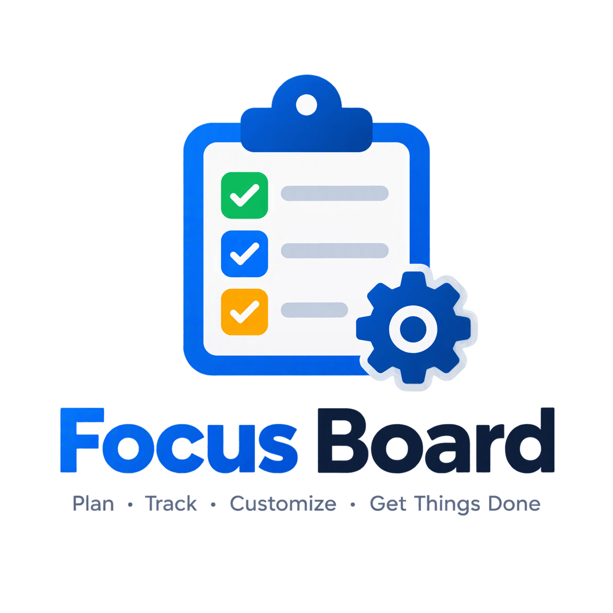

<p align="center">
  
</p>

# FocusBoard

**Plan • Track • Customize • Get Things Done**

FocusBoard is a lightweight, offline task planner for Windows. Your tasks live in
plain JSON files on your own machine — no account, no cloud, no network calls and
no telemetry. What makes it different is that **you define the shape of a task**:
add any fields you need, and reuse dropdown masters (like Status or Priority)
across them.

## Download

No build required: download `focusboard.exe` from the
[latest release](../../releases/latest) and run it on Windows 10/11. It is
self-contained — nothing else to install and no account to create.

## Features

- **Your fields, your workflow.** Eight field types — text, long text, number,
  date, date & time, checkbox, dropdown and multi-select. Mark fields required,
  give them defaults, reorder them, archive them without losing data, and choose
  which ones appear as table columns (up to five custom columns).
- **Reusable dropdown masters.** Define a list once, use it in many fields.
  Rename an option and every task updates instantly; give options colours and see
  them as chips in the table. Archiving hides an option from pickers but keeps the
  value on existing tasks.
- **A real task form.** "New task" opens a modal form — nothing is saved until you
  press Save, and an empty title is rejected. Clicking a row reopens the same form
  pre-filled; Cancel discards your edits. Single-select fields are inline dropdowns.
- **A table that stays aligned.** Drag rows to set your own priority order, sort
  by any column, search, filter (AND-combined), show archived tasks, and rely on
  long values being elided instead of pushing columns out of place.
- **Remembers how you like it.** Window size and position (clamped to your screen),
  light / dark / follow-system theme, and a collapsible sidebar are all persisted.
- **Local-only and safe.** Four JSON files in `%LOCALAPPDATA%\FocusBoard\`, written
  atomically with a `.bak` per file and seven daily backups. Bad data falls back to
  the backup instead of being reset, and only one instance can run at a time.
  Export and import are just folder copies you control.

## Getting started

FocusBoard is a Windows 10/11 desktop app, built with Rust and Slint.

Prerequisites:

- [Rust](https://rustup.rs/) stable, with the `x86_64-pc-windows-gnu` toolchain.
- MinGW-w64 (e.g. installed via `winget install BrechtSanders.WinLibs.POSIX.UCRT`)
  with its `bin` directory on your `PATH`. `build.rs` uses `windres` to embed the
  application icon, and the GNU toolchain needs `gcc`/`as`/`dlltool`.

```powershell
cargo run                          # development build
cargo test                         # unit tests
cargo clippy --all-targets -- -D warnings
cargo build --release              # target\release\focusboard.exe
```

The release executable is self-contained — it only links Windows system DLLs, so
there is nothing to ship alongside it. On first launch FocusBoard seeds three
editable fields (Status, Priority, Due date) so there is something to try.

If you replace `fb.png`, regenerate the Windows icon before rebuilding:

```powershell
powershell -File tools\make_icon.ps1
```

## Where things live

| Path | Purpose |
|---|---|
| `ui/` | Slint UI: theme, shared models, pages and widgets |
| `src/` | Rust: model, value encoding, storage, table logic and app wiring |
| `features.md` | Full feature reference and the acceptance checklist |
| `agents.md` | Architecture rules, storage invariants and measured budgets |
| `fb.png` / `fbl.png` | Product icon and README banner |
| `fb.ico` / `icon.rc` | Generated Windows icon resource |

## Data and privacy

Everything is stored in `%LOCALAPPDATA%\FocusBoard\` as four pretty-printed JSON
files (`lists.json`, `fields.json`, `tasks.json`, `settings.json`). FocusBoard
never contacts a network, sends telemetry, or requires an account. Only one copy
can run at a time so the files are never written by two processes.

## License

FocusBoard is licensed under the [GNU GPL v3.0](LICENSE).

Note: the UI uses [Slint](https://slint.dev/), which is available under GPLv3 or a
commercial license. If you want to distribute FocusBoard under different terms,
you need an appropriate Slint license.
